# Filmio — Movie Community Web Application

Filmio is a full-stack web application for movie enthusiasts, developed as part of the **Web Programming Application Project** at **Oulu University of Applied Sciences (Autumn 2026)**. Users can discover movies, write reviews, manage favourites and participate in movie groups.

## Table of Contents
- [Project Introduction](#project-introduction)
- [Tech Stack](#tech-stack)
- [Key Features](#key-features)
- [System Architecture](#system-architecture)
- [Project Structure](#project-structure)
- [Installation & Setup](#installation--setup)
- [API Documentation](#api-documentation)
- [Automated Tests](#automated-tests)
- [Project Documentation](#project-documentation)
- [Team & Development](#team--development)
- [License](#license)

## Project Introduction

Filmio combines movie information from [The Movie Database (TMDB)](https://www.themoviedb.org/) with user-generated reviews, favourite lists and community groups. 

The application consists of three layers: a **React** frontend, a **Node.js/Express** REST API and a **PostgreSQL** database. Docker Compose provides a local development environment.

[⬆️ Back to top](#table-of-contents)

## Tech Stack

| Layer | Technologies |
| --- | --- |
| Frontend | React 19, Vite, React Router, CSS |
| Backend | Node.js, Express 5, REST API |
| Database | PostgreSQL 15, `pg` |
| Authentication | bcrypt, JSON Web Tokens (JWT), HttpOnly refresh-token cookies |
| Real-time communication | Socket.IO |
| External movie data | TMDB API |
| Testing | Jest, Supertest |
| Development environment | Docker, Docker Compose, Git, GitHub |

[⬆️ Back to top](#table-of-contents)

## Key Features

### Movie Discovery
- Browse movies currently showing in cinemas.
- Search movies by title and filter by genre or year.
- Open individual movie pages with details from TMDB.

### Accounts and Security
- Register with an email address and a password that is at least 8 characters long.
- Log in and log out.
- Passwords are stored as bcrypt hashes.
- Short-lived access tokens and rotating refresh tokens.
- Delete a user account.
- Automatic logout after 10 minutes of inactivity.

### Reviews and Favourites
- Write movie reviews with text and a star rating from 1 to 5.
- Read reviews associated with individual movies.
- Add and remove favourite movies.
- Share a favourite list using a public link.

### Movie Groups
- Browse public group listings and create groups.
- Request group membership and manage invitations.
- Group owners can manage membership requests and members.
- Group members can add and remove movies in group.
- Group chat uses Socket.IO for real-time communication.
- If a group owner deletes their account, the group stays alive and the owner becomes "deleted user".

### Responsive Interface
- CSS layouts adapt to different screen sizes. Mobile and desktop views can be tested using browser developer tools.

[⬆️ Back to top](#table-of-contents)

## System Architecture

```text
                     Movie data
                  TMDB REST API
                       |
                       v
Browser            Node.js / Express          PostgreSQL
React + Vite <---> REST API (port 3001) <---> Database
     |                    |
     +---- Socket.IO -----+  (group chat)

JWT access token: API authorization
HttpOnly refresh cookie: session renewal
```

The React application communicates with the backend over HTTP. The backend fetches movie information from TMDB, validates access rights and stores Filmio-specific data in PostgreSQL.

### Database Diagram

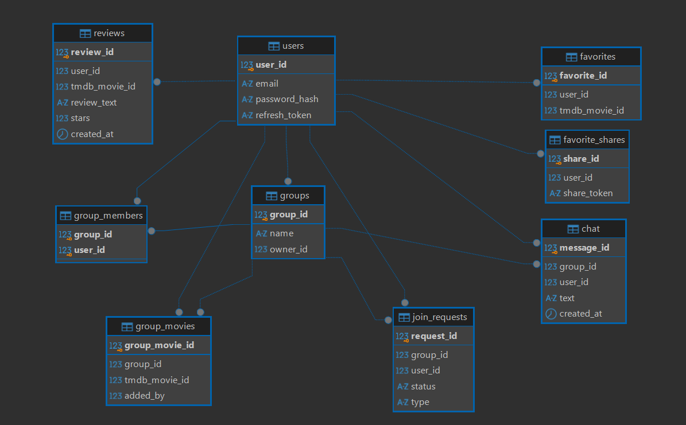

[⬆️ Back to top](#table-of-contents)

## Project Structure

```text
filmio/
├── backend/
│   ├── helper/              # Database, authentication and helpers
│   ├── routes/              # User, movie, group and favourites APIs
│   ├── test/                # Jest / Supertest tests
│   ├── index.js             # Express and Socket.IO server
│   └── package.json
├── database/
│   └── init.sql             # Initial PostgreSQL schema
├── documentation/
│   ├── database_er_diagram.png
│   ├── REST-API-Documentation.md
│   ├── Timesheet.pdf
│   └── User interface design.pdf
├── frontend/
│   ├── src/
│   │   ├── api/             # Client-side API helpers
│   │   ├── components/      # Reusable UI components
│   │   ├── contexts/        # Authentication context
│   │   └── pages/           # Application pages
│   └── package.json
├── docker-compose.yml
├── .env.example
├── LICENSE
└── README.md
```

[⬆️ Back to top](#table-of-contents)

## Installation & Setup

### Prerequisites
- [Git](https://git-scm.com/)
- [Docker Desktop](https://www.docker.com/products/docker-desktop/) with Docker Compose
- A TMDB API key (register at [TMDB](https://www.themoviedb.org/))

### 1. Clone the repository

```bash
git clone  https://github.com/WebProgGroup17/filmio.git 
cd filmio
```


### 2. Configure environment variables

Copy the example file to `.env` **in the project root**, next to `docker-compose.yml`:

**Git Bash / macOS / Linux:**
```bash
cp .env.example .env
```

**PowerShell:**
```powershell
Copy-Item .env.example .env
```

Open `.env` and set the following values:

| Variable | Purpose |
| --- | --- |
| `DB_USER` | PostgreSQL user |
| `DB_PASSWORD` | PostgreSQL password |
| `DB_NAME` | PostgreSQL database name |
| `DB_PORT` | Host database port (default: `5432`) |
| `PORT` | Backend port (default: `3001`) |
| `FRONTEND_PORT` | Frontend host port (default: `3000`) |
| `TMDB_API_KEY` | Your TMDB API key |
| `JWT_SECRET` | Signing secret for access tokens |
| `JWT_REFRESH_SECRET` | Separate signing secret for refresh tokens |
| `VITE_API_URL` | API URL used by the frontend, typically `http://localhost:3001` |

Generate **two different** secrets, running this command twice:

```bash
node -e "console.log(require('crypto').randomBytes(48).toString('hex'))"
```

### 3. Start the application with Docker

```bash
docker compose up -d --build
```

Default addresses from the provided Compose configuration:

| Service | Address |
| --- | --- |
| Frontend | http://localhost:3000 |
| Backend | http://localhost:3001 |
| PostgreSQL | localhost:5432 |

The Vite development server runs on port `5173` **inside** its container, but Docker publishes it to the host port given by `FRONTEND_PORT` (default `3000`).

Check container status and logs:

```bash
docker compose ps
docker compose logs -f backend
```

Stop the containers without removing the database data:

```bash
docker compose down
```

[⬆️ Back to top](#table-of-contents)

## API Documentation

**Base URL:** `http://localhost:3001`

| Method | Endpoint | Description |
| --- | --- | --- |
| `GET` | `/` | Backend health check |
| `POST` | `/users/signup` | Create an account |
| `POST` | `/users/login` | Log in and receive an access token |
| `POST` | `/users/refresh` | Refresh the access token using an HttpOnly cookie |
| `POST` | `/users/logout` | Log out and clear refresh-token session |
| `DELETE` | `/users/me` | Delete the authenticated account |
| `GET` | `/movies/now-playing` | Movies currently showing in Finland |
| `GET` | `/movies/search` | Search/filter movies |
| `GET` | `/movies/:id` | Get movie information |
| `GET` | `/movies/:id/reviews` | List movie reviews |
| `POST` | `/movies/:id/reviews` | Add a review |
| `GET` | `/favourites` | Get personal favourites |
| `POST` | `/favourites` | Add a favourite |
| `POST` | `/favourites/share` | Create a shareable favourites link |
| `GET` | `/favourites/share/:shareToken` | View shared favourites |
| `GET` | `/groups` | List groups |
| `POST` | `/groups` | Create a group |
| `GET` | `/groups/my` | Get user's groups |
| `POST` | `/groups/:groupId/join` | Request to join a group |
| `GET` | `/groups/:groupId` | View a group (member access) |
| `POST` | `/groups/:groupId/movies` | Add a movie to a group |

Protected routes use `Authorization: Bearer <access_token>`. Refresh requests must include credentials so the browser sends the HttpOnly cookie. For request bodies, responses, permissions and more endpoints, see the **[full REST API documentation](documentation/REST-API-Documentation.md)**.

[⬆️ Back to top](#table-of-contents)

## Automated Tests

Backend route tests use **Jest** and **Supertest**. Test files included in this project snapshot are:

- `backend/test/login.test.js`
- `backend/test/logout.test.js`
- `backend/test/register.test.js`
- `backend/test/review.test.js`
- `backend/test/account-deletation.test.js`


Run tests from the backend directory (requires Node.js and installed dependencies):

```bash
cd backend
npm install
npm test
```

[⬆️ Back to top](#table-of-contents)

## Project Documentation

- [Database ER diagram](documentation/ER-diagram.png)
- [REST API documentation](documentation/REST-API-Documentation.md)
- [User interface design (PDF)](documentation/User%20interface%20design.pdf)
- [Timesheet (PDF)](documentation/Timesheet.pdf)

### Screenshots

* Front Page:

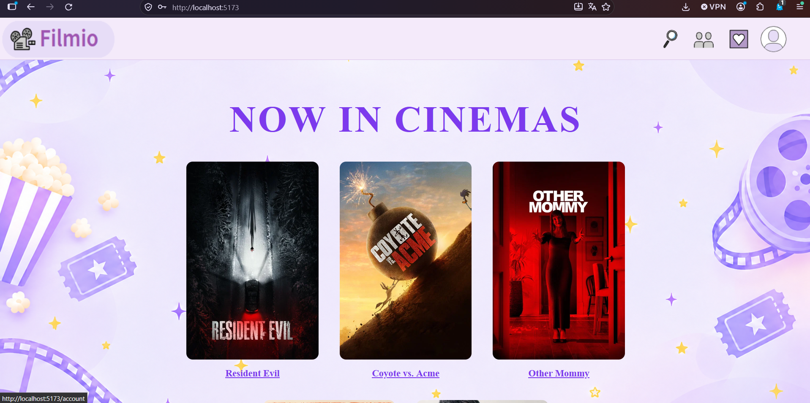

* Login Page:

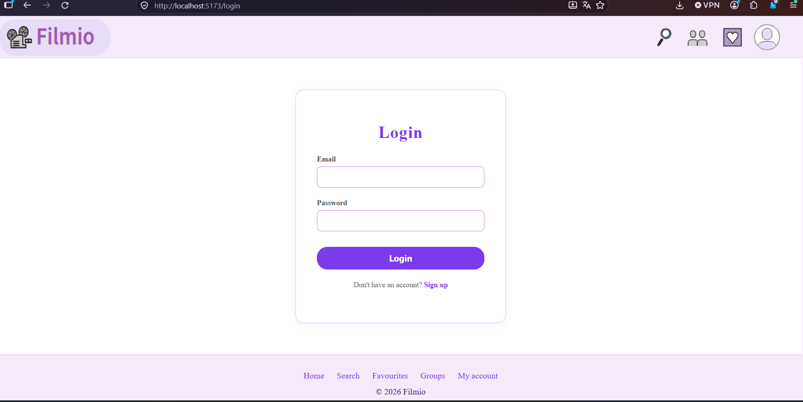

* Sign Up Page:

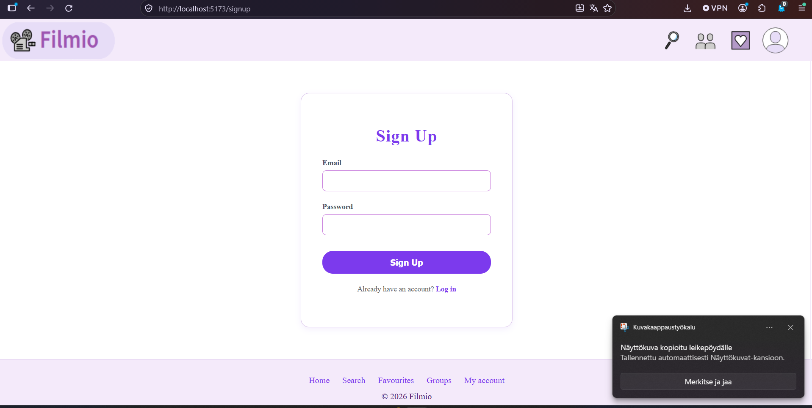

* Movie Search:

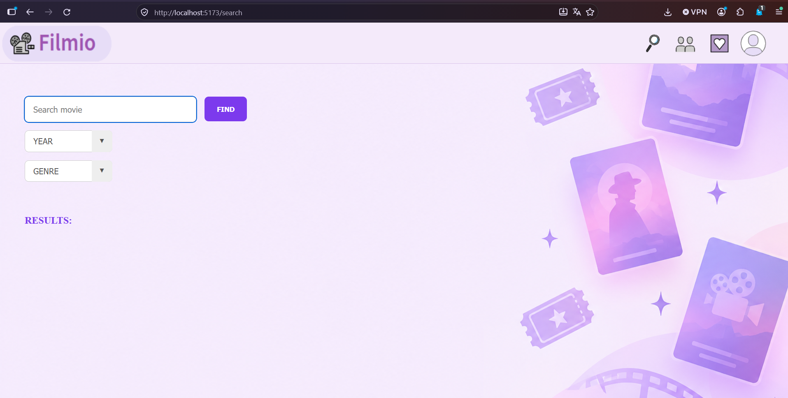

* Movie Details:

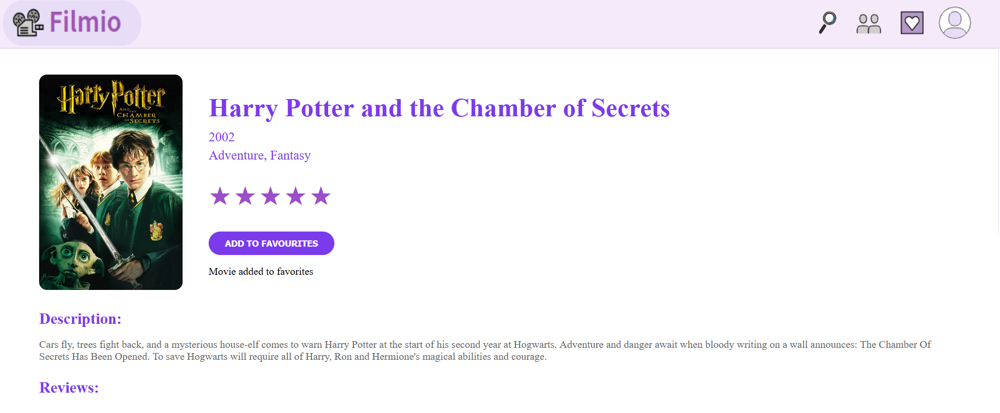

* Movie Reviews:

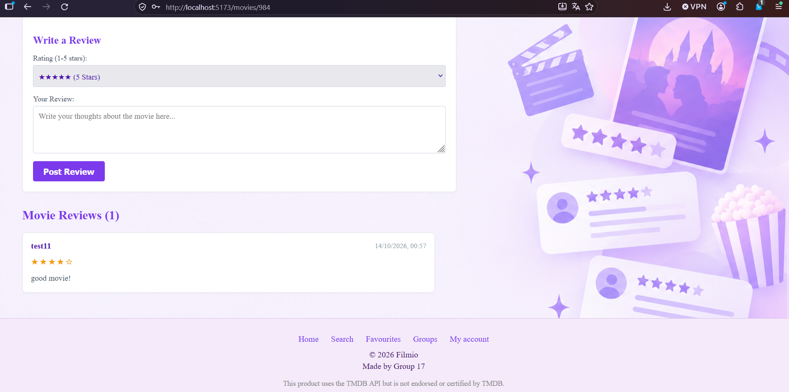

* Groups:

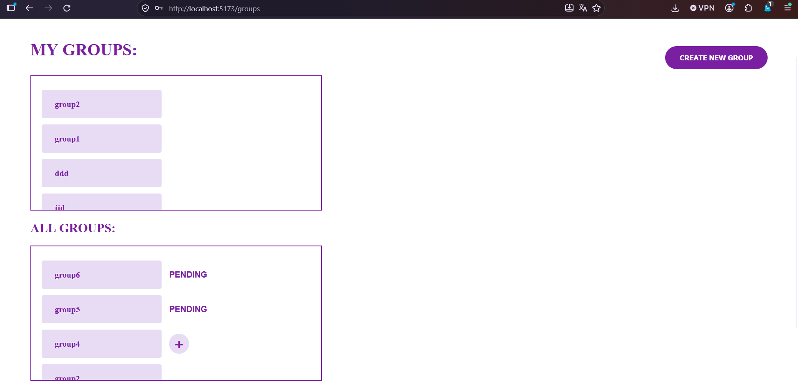

* Group Details:

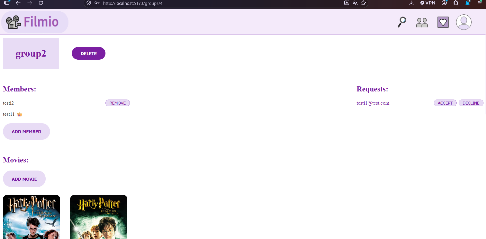

* Group Chat:

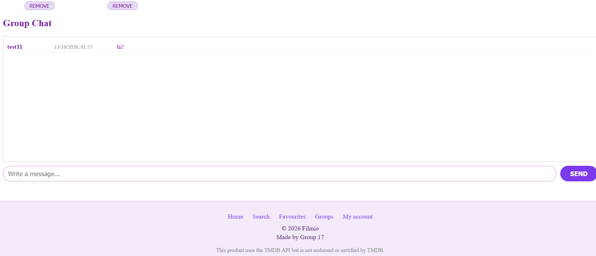

* Favourites:

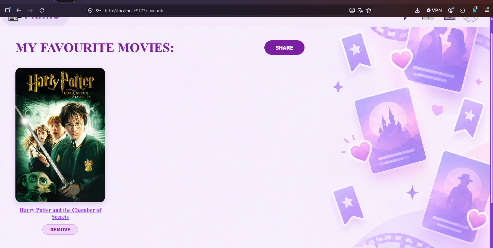

* Logout:

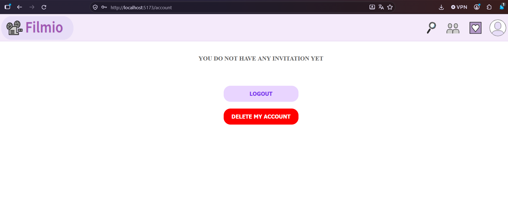

[⬆️ Back to top](#table-of-contents)

## Team 

All team members participated across all areas of the project.
Primary responsibilities were distributed as follows:

|Author|Primary Responsibilities|
|--------|-------------|
|[@juanyu0417](https://github.com/JuanYu0417)|User account page, review function in one movie page, chat function in one group page |
|[@jummijammi](https://github.com/jummijammi)|Search page, Groups page|
|[@tinnihkis](https://github.com/tinnihkis)|Styles, responsive design, favourites share|
|[@ecedevere](https://github.com/ecedevere)|Frontpage, one group page, one movie page|

All other parts of the project were made together.

[⬆️ Back to top](#table-of-contents)

## License

This project is licensed under the [MIT License](LICENSE).
